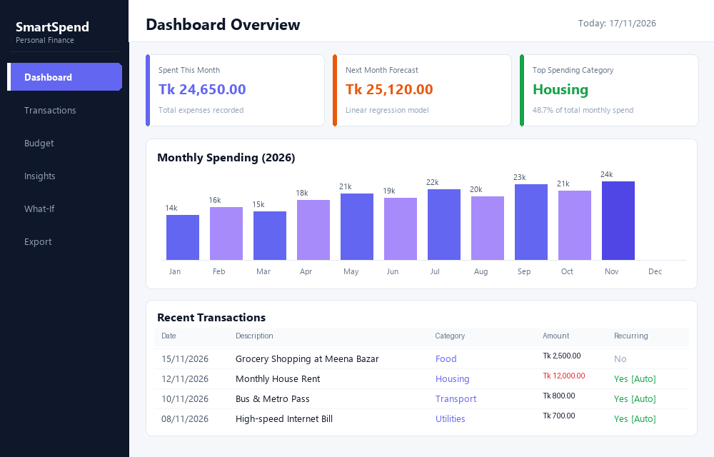
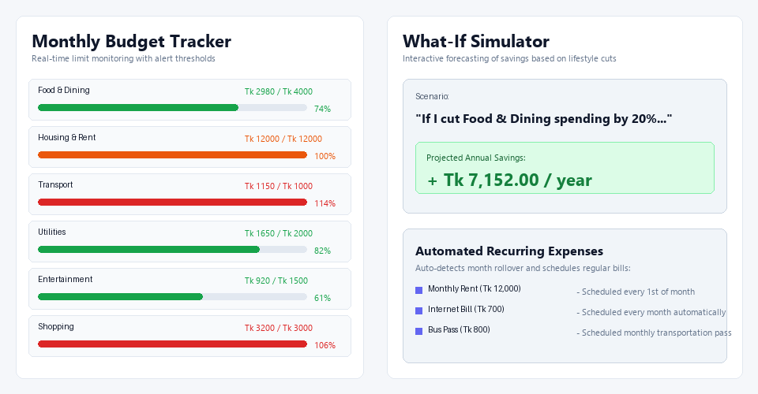
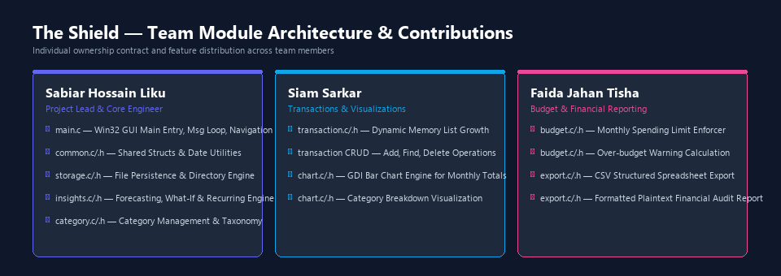

# SmartSpend — Personal Finance Tracker

<p align="center">
  
</p>

<p align="center">
  
  
  
  
  
</p>

---

## 📖 Overview

**SmartSpend** is a high-performance personal expense and budget management application built for a University Software Development course by team **The Shield**.

The application is written in **pure C (C11)** and features a modern, responsive **Win32 native desktop graphical interface (GUI)** alongside terminal and sample automation modes. It requires **zero third-party runtime libraries**, compiling down to a lightweight, standalone native binary.

---

## 🖥️ Application Interface

<p align="center">
  
</p>

### Key Interface Highlights:
- **Navigation Sidebar**: Switch between Dashboard, Transactions, Budget, Insights, What-If Simulator, and Export with a single click.
- **Dynamic Stat Cards**: Instant visibility over monthly expenditures, predictive forecast, and top spending category.
- **Custom GDI Bar Charts**: 12-month spending bar chart and categorical breakdowns rendered natively via Windows GDI.
- **Full-Featured Transaction Grid**: Fast, sortable Win32 ListView with item selection, addition, and safe deletion.

---

## 🌟 Key Features

<p align="center">
  
</p>

| Feature | Description |
|---|---|
| **📊 Smart Dashboard** | Real-time aggregate statistics, monthly trends, and recent transaction log. |
| **💳 Transaction Management** | Add, categorize, date, and delete expenses with dynamic array memory reallocation. |
| **🎯 Budget Enforcer** | Category-level spending limits with real-time visual progress bars and alert thresholds (Green / Orange / Red). |
| **📈 Linear Regression Forecast** | Predictive algorithms analyze past 6 months of spending to forecast the upcoming month. |
| **💡 "What-If" Simulator** | Interactive tool calculating projected 1-year financial savings if specific categories are trimmed (e.g. *"Cutting Food by 20% saves Tk 7,152/yr"*). |
| **🔄 Automated Recurring Expenses** | Recurring subscriptions, rent, and utility bills automatically populate on month change without duplicates. |
| **📁 File Persistence & Exports** | Robust file persistence (`.dat`), CSV spreadsheet export, and formatted plain-text financial audit reports. |

---

## 👥 Team Contributions & Module Ownership

The Shield follows a strict architectural contract where each module has a designated owner:

<p align="center">
  
</p>

### Module Responsibility Breakdown

| Team Member | Role | Owned Files | Core Features & Contributions |
|---|---|---|---|
| **Sabiar Hossain Liku** | **Lead & Core Engineer** | `src/main.c`<br>`src/common.c/.h`<br>`src/storage.c/.h`<br>`src/insights.c/.h`<br>`src/category.c/.h` | • Win32 GUI main event loop, navigation system, and modal dialogs.<br>• Shared data structures (`Transaction`, `Budget`, `TransactionList`).<br>• Storage engine: binary/text persistence with auto-directory recovery.<br>• Linear regression monthly forecasting & What-If savings engine.<br>• Month-rollover recurring expense auto-scheduler.<br>• Category registry, taxonomy defaults, and dynamic extraction. |
| **Siam Sarkar** | **Data & Visuals Engineer** | `src/transaction.c/.h`<br>`src/chart.c/.h` | • Dynamic memory list reallocation (`initList`, `freeList`, growth).<br>• Core transaction CRUD operations (`addTransaction`, `deleteTransaction`, `findTransaction`).<br>• Custom GDI-rendered 12-month bar chart engine.<br>• Visual category breakdown charting component. |
| **Faida Jahan Tisha** | **Budget & Export Engineer** | `src/budget.c/.h`<br>`src/export.c/.h` | • Monthly budget limit enforcer and threshold calculations.<br>• Over-budget warning status detection.<br>• Formatted CSV transaction export engine (`exportCSV`).<br>• Comprehensive text financial summary report generator (`exportReport`). |

---

## 🚀 Getting Started

### Prerequisites
- **Compiler**: GCC with C11 support (e.g., MinGW-w64 / MSYS2)
- **Build Tool**: GNU Make
- **Operating System**: Windows 10 or Windows 11

### 🛠️ Build Commands

All operations are automated via the included `Makefile`:

```bash
# 1. Build the complete native desktop GUI executable
make

# 2. Run the automated test suite (verifies all core logic)
make test

# 3. Populate data/ with sample transactions
make sample

# 4. Clean build outputs and test runners
make clean
```

### 🏃 Running the Application
Double-click `smartspend.exe` in File Explorer or launch via command line:
```powershell
.\smartspend.exe
```

---

## 🧪 Testing & Verification

The project includes unit tests in `tests/test_main.c` testing:
- **Date Utilities**: String formatting, month boundary checks, and matching.
- **Transaction Memory**: Dynamic resizing, insertion, deletion, and searching.
- **Category Taxonomy**: Dynamic discovery and lookup.
- **Insights & Analytics**: Spending sum, top category calculation, linear regression, and recurring logic.
- **Budget Enforcer**: Threshold evaluation and over-budget triggers.
- **Exporting**: File format integrity for CSV and text report outputs.

Run all tests anytime with:
```bash
make test
```
```text
=== SmartSpend Unit Tests ===
Running test_common_date_utils... PASS
Running test_transaction_crud... PASS
Running test_category_operations... PASS
Running test_insights_and_whatif... PASS
Running test_budget_operations... PASS
Running test_export_operations... PASS
=============================
Summary: 6 / 6 tests passed successfully.
```

---

## 📁 Project Directory Structure

```text
smartspend/
├── assets/                  # High-resolution documentation and UI preview graphics
│   ├── banner.png
│   ├── dashboard_preview.png
│   ├── features_preview.png
│   └── team_contributions.png
├── data/                    # Local persistent storage (git-ignored)
│   ├── transactions.dat
│   └── budgets.dat
├── exports/                 # Generated CSV and report exports (git-ignored)
│   ├── transactions.csv
│   └── report.txt
├── src/                     # C source code and module headers
│   ├── budget.c / .h        # Budget limits and over-budget checks
│   ├── category.c / .h      # Category management and taxonomy
│   ├── chart.c / .h         # Custom GDI bar charting and progress bars
│   ├── common.c / .h        # Shared data structures and date utilities
│   ├── export.c / .h        # CSV and plaintext financial report generators
│   ├── gui.c / .h           # Win32 layout styling, custom controls, cards
│   ├── insights.c / .h      # Forecasting, What-If simulator, recurring bills
│   ├── main.c               # WinMain entry point, window procedures, dialogs
│   ├── storage.c / .h       # File read/write persistence
│   └── transaction.c / .h   # Dynamic array transaction list & CRUD
├── tests/                   # Automated unit test suite
│   └── test_main.c
├── .gitignore               # Strict ignore rules for binaries, data, and exports
├── Makefile                 # Unified build, test, and sample runner
└── README.md                # Comprehensive documentation with UI previews
```

---

## 📜 Coding & Git Standards

- **Standard**: C11 (`-std=c11 -Wall -Wextra`) with **zero compiler warnings**.
- **Memory Safety**: Every `malloc` / `realloc` is checked and freed cleanly.
- **Code Style**: 4-space indentation, braces on control structures, camelCase functions.
- **Git Workflow**:
  - All changes developed on descriptive feature branches (`liku/<feature>`).
  - Strict staging by filename.
  - Builds and tests pass cleanly before commits.

---

<p align="center">
  <b>SmartSpend</b> — Built with ❤️ by <i>The Shield</i>
</p>
